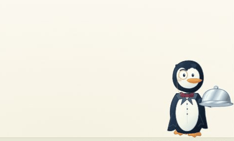

# ANIMAIL

**Miss IncrediMail?** ANIMAIL is an independent **IncrediMail alternative for Windows 10 and 11** by ASIA DESIGN LAB. Animated animal notifiers announce new mail, illustrated stationery dresses up your messages, and a combined inbox brings your accounts together.

**[Download the signed Windows installer](https://github.com/AsiaDesignLab/animail/releases/download/v0.12.72/ANIMAIL-Native-Setup-0.12.72.exe)** · [Release and checksum](https://github.com/AsiaDesignLab/animail/releases/tag/v0.12.72) · [Product website](https://animail.app/)

## Meet the animated characters

Your chosen character appears when new mail arrives. Each courier has its own entrance and greeting. You can preview the animations, turn spoken greetings off, or set the volume.

[Play the full character demos with sound](https://animail.app/animated-email-notifiers/#theatre-stage)

<table>
  <tr>
    <td align="center" width="25%"> <strong>Percy</strong> Penguin butler</td>
    <td align="center" width="25%"> <strong>Shelldon</strong> Tortoise postmaster</td>
    <td align="center" width="25%"> <strong>Captain Squawk</strong> Cockatoo town crier</td>
    <td align="center" width="25%"> <strong>Trixie</strong> Raccoon magician</td>
  </tr>
</table>

## Get started on Windows

1. Download **ANIMAIL-Native-Setup-0.12.72.exe** and run the installer. This is the Windows beta with a **30-day trial**.
2. Open ANIMAIL and connect a [compatible mailbox](https://animail.app/terms/#compatibility).
3. Open **Animal notifiers**, pick a character, and play its preview. Adjust greetings or volume under **Tools → Options → Notifiers**.
4. To try stationery, start a new message and open **Letters**. Choose an illustrated design and send yourself a test email.

The inbox screenshot shows an earlier Windows build with demonstration mail. Check the installer’s **Digital Signatures** tab in Windows file properties and compare the SHA-256 hash with [SHA256SUMS.txt](https://github.com/AsiaDesignLab/animail/releases/download/v0.12.72/SHA256SUMS.txt).

## Moving from IncrediMail

Connect a compatible mailbox to read messages still stored by your mail provider. For mail stored in old IncrediMail archive files, see the [migration and compatibility guidance](https://animail.app/incredimail-alternative/).

## Help and other downloads

- [Help and compatibility](https://animail.app/support/)
- [Windows release notes and Linux beta downloads](https://animail.app/download/)
- [Trial and membership options](https://animail.app/pricing/)
- [Software licence and terms](https://animail.app/terms/) · [Privacy](https://animail.app/privacy/)

[More software by ASIA DESIGN LAB](https://www.adlsoftware.net/)
