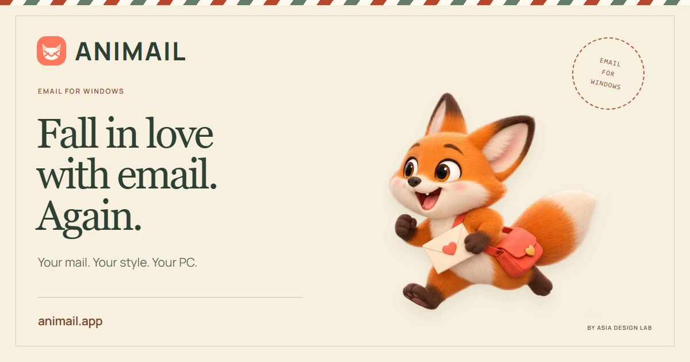
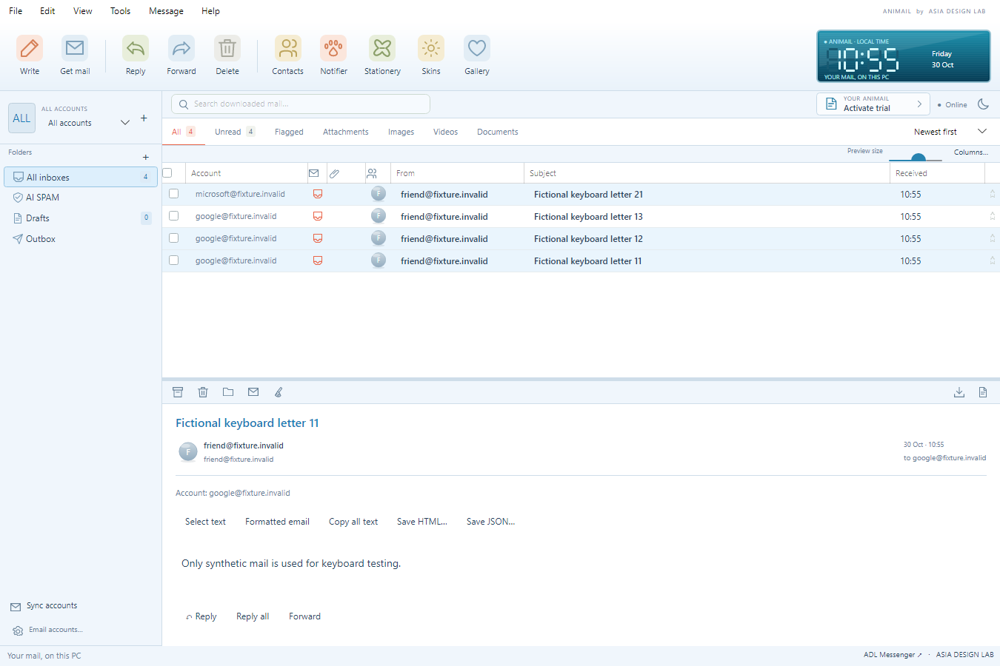
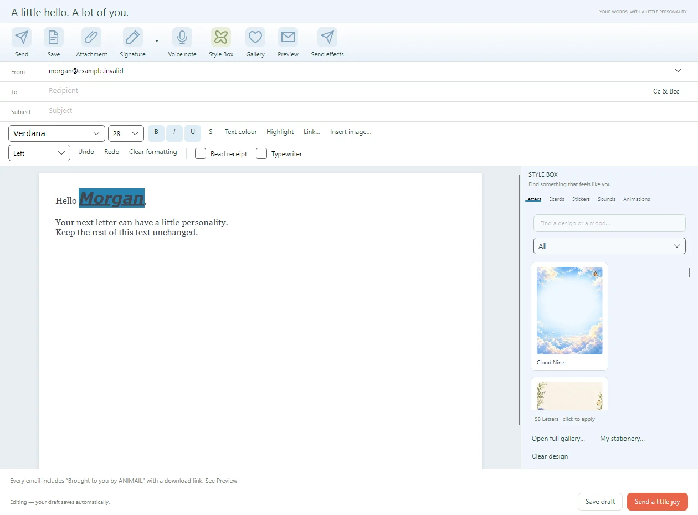
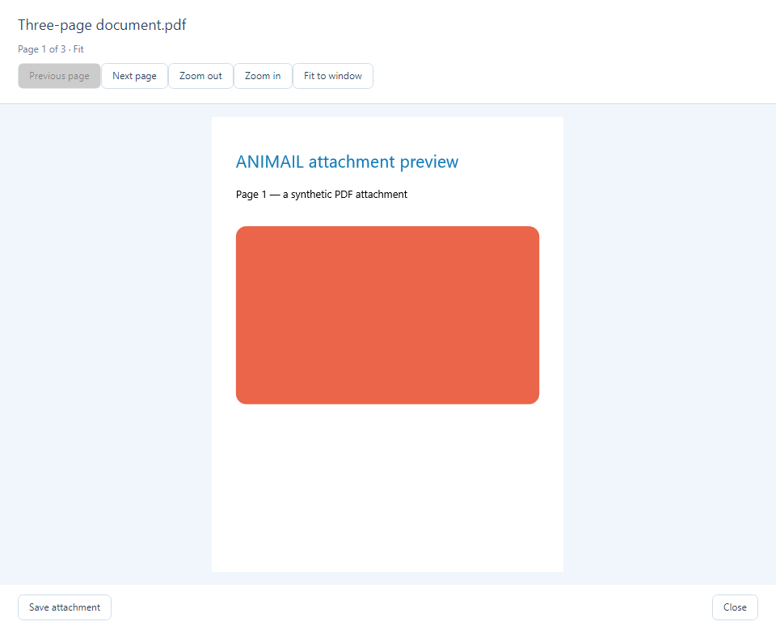
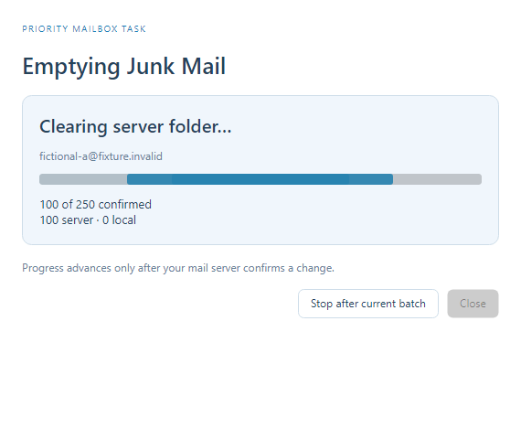

# ANIMAIL

**Miss IncrediMail?** ANIMAIL is ASIA DESIGN LAB’s independent **IncrediMail alternative for Windows**, with a Linux beta for Ubuntu and Debian. It brings animated animal notifiers, illustrated stationery, and a combined inbox to desktop email.

**[Download for Windows](https://github.com/AsiaDesignLab/animail/releases/tag/v0.12.72)** · **[Download the Linux beta](https://github.com/AsiaDesignLab/animail/releases/tag/v0.12.69-linux-beta)** · [Official website](https://animail.app/)

## Download and install

| Platform | Release | Requirements and setup |
| --- | --- | --- |
| **Windows 10 and 11** | [Signed v0.12.72 installer and checksum](https://github.com/AsiaDesignLab/animail/releases/tag/v0.12.72) | Run the installer, open ANIMAIL, and connect a compatible mailbox. The Windows beta includes a **30-day trial**. |
| **Ubuntu 24.04 LTS** | [v0.12.69 Linux beta · Ubuntu package](https://github.com/AsiaDesignLab/animail/releases/tag/v0.12.69-linux-beta) | amd64, GNOME 46, X11 or Wayland with XWayland. [Ubuntu installation guide](https://animail.app/linux/#ubuntu) |
| **Debian 13** | [v0.12.69 Linux beta · Debian package](https://github.com/AsiaDesignLab/animail/releases/tag/v0.12.69-linux-beta) | amd64, Xfce, X11. [Debian installation guide](https://animail.app/linux/#debian) |

On Linux, install the `.deb` for your distribution using the official guide, then open ANIMAIL from your applications menu under your normal account with the desktop login keyring unlocked. The Linux release includes the official Ed25519-signed manifests and checksums. Use the [Linux guide](https://animail.app/linux/) for verification, updates, and beta compatibility.

The feature guide below describes the Windows app. Custom Corporate Design Pack installers are for Windows. For Linux sign-in, payments, or protected paid artwork, check the beta compatibility notes.

## Meet the animated characters

Your chosen courier appears when new mail arrives. Each character has its own entrance and greeting. Pick a collection, preview a character, and set the greeting volume or quiet mode. The original crew is joined by Halloween costumes and optional character packs.

[Play the full character demos with sound](https://animail.app/animated-email-notifiers/#theatre-stage) · [Halloween notifiers](https://animail.app/halloween-email-notifiers/) · [Character packs and Premium VIP](https://animail.app/pricing/)

<table>
  <tr>
    <td align="center" width="25%"> <strong>Percy</strong> Penguin butler</td>
    <td align="center" width="25%"> <strong>Shelldon</strong> Tortoise postmaster</td>
    <td align="center" width="25%"> <strong>Captain Squawk</strong> Cockatoo town crier</td>
    <td align="center" width="25%"> <strong>Trixie</strong> Raccoon magician</td>
  </tr>
</table>

## What you can do with ANIMAIL

### Manage your mail

- **Accounts and combined inbox.** Connect Gmail, Microsoft, and compatible IMAP/SMTP accounts. Search across downloaded mail, filter by unread messages or attachments, and pause sync for individual accounts. Replies use the receiving account. [Combined inbox](https://animail.app/combined-inbox/)
- **Offline email and sending.** Read downloaded messages and attachments offline. Use Drafts and Outbox to pick up work or review queued messages. [Drafts and Outbox](https://animail.app/drafts-and-outbox/)
- **In-app attachment previews.** Zoom and rotate pictures, browse PDFs, play supported audio and video, read text from supported documents, and inspect ZIP contents from the message. [Windows release notes](https://animail.app/updates/)

### Write and personalize

- **Rich-text editor.** Format selected text, choose Windows fonts or ANIMAX FONT, add colours and highlights, and insert links and resizable images. [Email editor](https://animail.app/email-editor/)
- **Stationery, ecards, and effects.** Use illustrated letter papers, editable ecards, stickers, embedded GIFs, and typewriter sounds. Build reusable stationery with your own logo and choose per-account email signatures. [Creative email](https://animail.app/creative-email/) · [My stationery](https://animail.app/my-stationery/) · [Signatures](https://animail.app/email-signatures/)
- **Contacts and little details.** Use address suggestions, buddy icons, and paper-plane send effects to make the app your own. [Contacts and buddy icons](https://animail.app/contacts-buddy-icons/) · [Send effects](https://animail.app/email-send-effects/)

<table>
  <tr>
    <td width="50%" valign="top"><strong>Rich-text editor</strong> </td>
    <td width="50%" valign="top"><strong>Illustrated stationery</strong> </td>
  </tr>
</table>

### Keep the inbox tidy and the mail portable

- **Local AI Spam Guardian.** Adjust detection strength, protect contacts and past correspondents, and review or restore flagged messages. [AI Spam Guardian](https://animail.app/ai-spam-guardian/)
- **Verification-code courier.** A fox brings supported incoming email codes to your desktop so you can copy them on demand. [Verification-code courier](https://animail.app/verification-code-courier/)
- **Mailbox cleanup.** Preview matching messages by sender and account, choose how to remove them, and follow progress during cleanup. [Sender cleanup and Empty Trash](https://animail.app/sender-cleanup/)
- **Backup, restore, and export.** Create a password-encrypted backup of downloaded mail, attachments, accounts, drafts, and settings. Copy email or save HTML and JSON exports. [Backup and restore](https://animail.app/email-backup-restore/) · [Email export](https://animail.app/email-copy-export/)
- **Windows startup and updates.** Keep ANIMAIL available in the system tray and use the app’s background update settings. [Background updates](https://animail.app/background-updates/)

<table>
  <tr>
    <td width="50%" valign="top"><strong>PDF attachment preview</strong> </td>
    <td width="50%" valign="top"><strong>Mailbox cleanup progress</strong> </td>
  </tr>
</table>

Screenshots use demonstration mail and include earlier Windows builds. [Full feature catalogue](https://animail.app/features/)

## Try these workflows

1. **Make a personalized letter.** Start a new message, open **Letters**, choose an illustrated design, and add text or a sticker. Send yourself a test email to see how it looks in your mail app.
2. **Manage two accounts from one view.** Connect two compatible mailboxes, then choose **All accounts → All inboxes**. Open a message, check its account label, and reply from that account.
3. **Set up a notifier.** Open **Animal notifiers**, choose a courier and preview it. Use **Tools → Options → Notifiers** to adjust how it appears or plays sound.
4. **Make a portable backup.** On Windows, choose **File → Backup & restore**, set a backup password, and save the file somewhere you can access when moving to another PC.

## Moving from IncrediMail

Connect a compatible mailbox to download messages still held by your mail provider. Check the [IncrediMail migration guide](https://animail.app/incredimail-alternative/) for guidance on mail stored in legacy local archives.

## Help and verification

- [Provider compatibility](https://animail.app/terms/#compatibility) · [Help](https://animail.app/support/) · [Community](https://animail.app/community/)
- [Release notes](https://animail.app/updates/) · [Trial and membership options](https://animail.app/pricing/)
- [Software licence and terms](https://animail.app/terms/) · [Privacy](https://animail.app/privacy/)

On Windows, check the installer’s **Digital Signatures** tab and compare its SHA-256 hash with the checksum from the Windows release. For Linux, see the [signed package verification instructions](https://animail.app/linux/).

[More software by ASIA DESIGN LAB](https://www.adlsoftware.net/)
